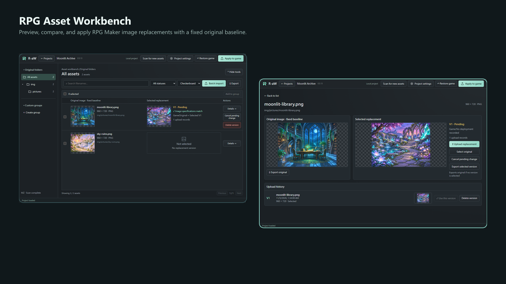
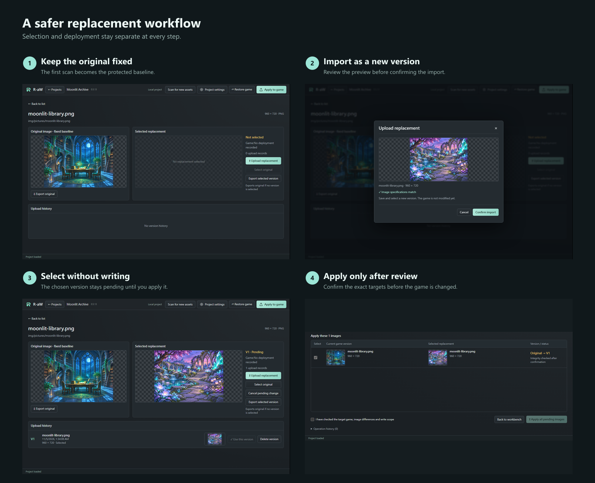

# RPG Asset Workbench (R-aW)

English · [繁體中文](docs/user/README.zh-TW.md) · [简体中文](docs/user/README.zh-CN.md) · [日本語](docs/user/README.ja.md)

**Preview, organize, replace, and restore RPG Maker images without losing sight of the original.**

R-aW is a Windows image asset manager for RPG Maker MV/MZ. It keeps a fixed original baseline, stores replacement versions separately, supports batch matching, and writes to the game only after an explicit confirmation.

## What it helps you do

- Browse original folders, search assets, and create custom groups.
- Compare a fixed original with the selected replacement and its version history.
- Import one static PNG or match a folder of replacement images in a batch.
- Stage changes without touching the game, then review the exact targets before applying.
- Restore selected game images from the preserved original baseline.
- Relink a moved game while keeping the managed project data.

## Download and run

When a package is available, download the Windows x64 ZIP from this repository's **Releases** page. GitHub's “Source code” ZIP is not a runnable application. If no release asset is listed, a download package is not yet available.

Extract the **entire ZIP** into a writable folder and open `RPG Asset Workbench.exe`. Keep all accompanying files; do not move only the EXE or run it inside the ZIP. The packaged application does not require a separate Node.js installation.

## A safer replacement workflow

1. Back up the game independently and create the project from a trusted, unmodified copy.
2. Let the first scan finish. That scan becomes the fixed original baseline; cancelling preserves progress for resuming, but an incomplete scan cannot be applied.
3. Browse or search the workbench. Click an original or replacement preview to inspect it at full size.
4. Drop one static PNG onto an asset to create a replacement version, or use batch import and review every match before confirming.
5. Selecting a version only stages the change. Open **Apply to game**, review the targets, and confirm before any game file is written.
6. Selecting the original also creates a pending change. Apply it to restore that asset while keeping replacement history.

### Three rules to remember

1. **The original baseline is fixed.** Later scans can add confirmed new paths, but they never overwrite an existing original backup.
2. **Selected is not deployed.** Importing or selecting a version does not modify the game; apply/restore always has a separate confirmation step.
3. **Unexpected external changes stop writes.** Apply and restore are blocked when game files no longer match the recorded state. There is no force-overwrite option.

The home-screen language control switches between English, Traditional Chinese, Simplified Chinese, and Japanese. Project settings provide naming, cover images, and location relinking. Custom groups can be renamed and their memberships changed without deleting image data.

## Data, upgrades, and deletion

- Tool data is stored in the Windows user's application data directory, not entirely beside the EXE. Moving or deleting the extracted application folder does not move or erase managed project data.
- Before upgrading, close R-aW and back up both the game and the complete tool data directory. Extract the new version into a separate folder. If existing projects are missing after an upgrade, stop and report the issue instead of recreating or deleting them.
- **Permanently deleting a project removes its tool-managed original backups, replacement versions, and recovery history. Game files stay in their current state; deletion does not restore them.** Restore and verify originals first if that is your intent.
- Removing a custom group or a member only removes classification links. Cancelling a pending change is different from deleting a version. Originals and deployed versions cannot be deleted individually.

## Compatibility and current limits

- RPG Maker MV/MZ with unencrypted or standard encrypted images. Custom encryption and modified engines are not guaranteed.
- Windows x64 is the current target. The minimum supported Windows version and ARM64 have not been validated.
- Static PNG only. JPEG, APNG, and disguised extensions are rejected. Maximum file size: 32 MiB.
- Normal image limit: 16,777,216 pixels. Replacement and batch imports may continue after confirmation up to 33,554,432 pixels; original scans and project covers keep the normal limit.
- Saved project data remains viewable when the game is offline, but writes are disabled until the location is valid again.
- After a failed operation, follow the recovery prompt and retain backups and error details.

## Project status

The current source version is **0.5.13**. Version 1.0 is being prepared and has not been announced as released. Clean-Windows, final-package, upgrade-compatibility, and final third-party-notice checks still have outstanding items.

Humans lead the project direction, requirements, decisions, and acceptance; AI handles software development.

## Reporting problems and license

Use this repository's Issues, if enabled. Include the R-aW, Windows, and RPG Maker versions; reproduction steps; expected and actual results; and relevant screenshots. Redact personal paths. Do not upload private games, encryption keys, or assets you are not authorized to share.

Licensed under the [MIT License with the Commons Clause](LICENSE), Copyright © 2026 Zeke Gan. You may use and modify the software, but may not sell the software or a paid product/service whose main value is the software; renaming it or changing the logo does not change that restriction. Using R-aW to create commercial games is allowed. Versions through 0.5.11 remain under plain MIT. Third-party components and game assets keep their own licenses.

[Version notes](docs/UPDATE_0.5.13.md) · [Developer and AI documentation](docs/development/INDEX.md)
