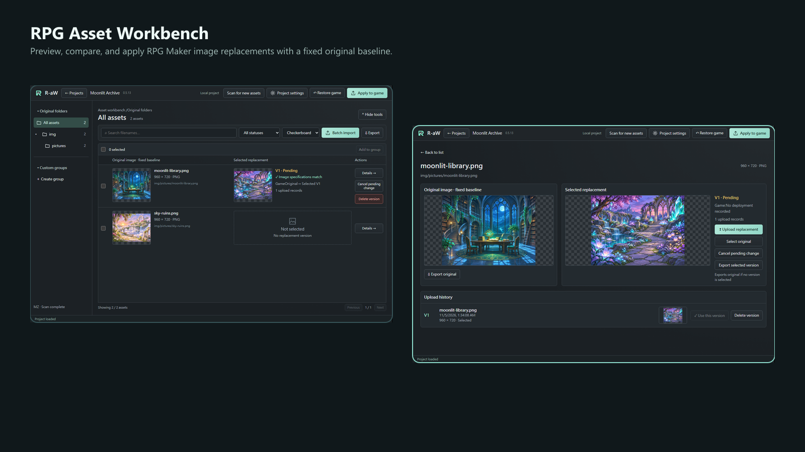
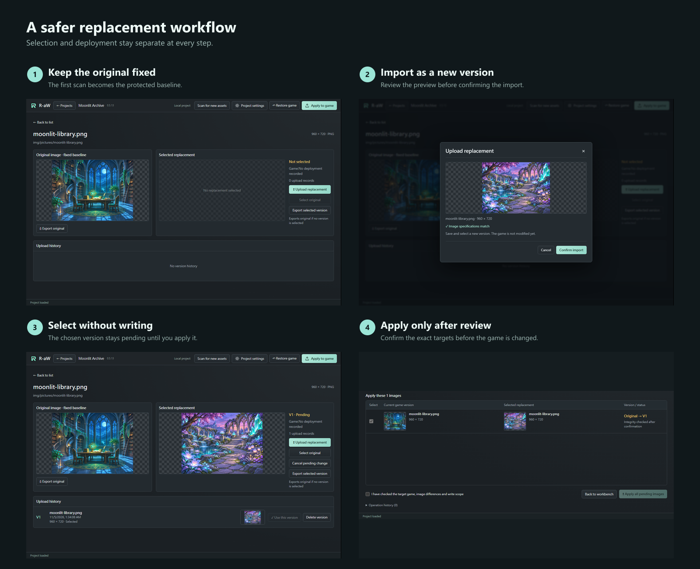

# RPG Asset Workbench（R-aW）

[English](../../README.md) · [繁體中文](README.zh-TW.md) · [简体中文](README.zh-CN.md) · 日本語

**RPG Maker の画像を、固定された元画像を見失うことなくプレビュー、整理、置換、復元できます。**

R-aW は Windows 向けの RPG Maker MV／MZ 画像素材管理ツールです。固定された元画像の基準を保存し、置換バージョンを分けて管理し、一括照合に対応します。ゲームへ書き込むのは明示的に確認した後だけです。

## できること

- 元のフォルダーを参照し、素材を検索してカスタムグループを作成できます。
- 固定された元画像、選択中の置換画像、アップロード履歴を比較できます。
- 静的 PNG を1枚ずつ取り込むか、フォルダー内の置換画像を一括照合できます。
- ゲームに触れず変更を選択し、対象を確認してから適用できます。
- 保存された元画像の基準から、選択したゲーム画像を復元できます。
- 移動したゲームを再リンクしながら、管理済みプロジェクトデータを保持できます。

## ダウンロードと起動

パッケージが用意されている場合は、このリポジトリの **Releases** ページから Windows x64 ZIP をダウンロードしてください。GitHub の「Source code」ZIP は実行可能なアプリではありません。release asset がなければ、ダウンロード用パッケージはまだ提供されていません。

**ZIP 全体**を書き込み可能なフォルダーへ展開し、`RPG Asset Workbench.exe` を開いてください。付属ファイルをすべて保持し、EXE だけを移動したり ZIP 内から実行したりしないでください。パッケージ版には別途 Node.js をインストールする必要はありません。

## より安全な置換手順

1. ゲームを別途バックアップし、信頼できる未変更のゲームコピーからプロジェクトを作成します。
2. 最初のスキャンが完了するまで待ちます。このスキャンが固定された元画像の基準になります。キャンセルしても再開用の進捗は残りますが、未完了のスキャンは適用できません。
3. ワークベンチで素材を参照または検索します。元画像や置換画像のプレビューをクリックすると拡大確認できます。
4. 静的 PNG を1枚素材へドロップして置換バージョンを作成するか、一括インポートを使用し、確定前にすべての照合結果を確認します。
5. バージョンの選択は変更を保留するだけです。「ゲームに適用」を開き、対象を確認してから確定すると、初めてゲームファイルへ書き込まれます。
6. 元画像を選び直した場合も保留中の変更になります。適用すると置換履歴を残したまま、その素材を復元できます。

### 覚えておく3つのルール

1. **元画像の基準は固定です。** 後のスキャンで確認済みの新しいパスを追加できますが、既存の元画像バックアップは上書きしません。
2. **選択は適用ではありません。** インポートやバージョン選択だけではゲームは変更されず、適用／復元には別の確認手順があります。
3. **予期しない外部変更があると書き込みを停止します。** ゲームファイルが記録状態と一致しない場合、適用と復元はブロックされます。強制上書きはありません。

ホーム画面の言語メニューで、英語、繁体字中国語、簡体字中国語、日本語を切り替えられます。プロジェクト設定では名前、カバー画像、場所の再リンクを管理できます。カスタムグループは画像データを削除せずに名前やメンバーを変更できます。

## データ、更新、削除

- ツールデータは Windows ユーザーのアプリケーションデータ領域に保存され、すべてが EXE の隣にあるわけではありません。展開したアプリフォルダーを移動または削除しても、管理済みプロジェクトデータは移動・消去されません。
- 更新前に R-aW を終了し、ゲームとツールデータ領域全体の両方をバックアップしてください。新しいバージョンは別のフォルダーへ展開します。更新後に既存プロジェクトが見つからない場合は、再作成や削除をせず、操作を止めて報告してください。
- **プロジェクトを完全に削除すると、ツールが管理する元画像バックアップ、置換バージョン、復元履歴が削除されます。ゲームファイルはその時点の状態を維持し、プロジェクト削除では復元されません。** 元画像へ戻すことが目的なら、先に復元して確認してください。
- カスタムグループやメンバーを外しても分類リンクだけが削除されます。保留中の変更のキャンセルとバージョン削除は異なり、元画像と適用済みバージョンは個別に削除できません。

## 対応範囲と現在の制限

- 暗号化なし、または標準暗号化画像を使用する RPG Maker MV／MZ。独自暗号化や改造エンジンは保証対象外です。
- 現在の対象は Windows x64 です。最低対応 Windows バージョンと ARM64 は未検証です。
- 静的 PNG のみ対応します。JPEG、APNG、偽装した拡張子は拒否します。ファイル上限は 32 MiB です。
- 通常の画像上限は 16,777,216 ピクセルです。置換画像と一括インポートは確認後に 33,554,432 ピクセルまで処理できますが、元画像スキャンとプロジェクトカバーは通常上限のままです。
- ゲームがオフラインでも保存済みデータは閲覧できますが、場所が再び有効になるまで書き込みは無効です。
- 操作に失敗した場合は復旧案内に従い、バックアップとエラー情報を保持してください。

## プロジェクト状況

現在のソースコードのバージョンは **0.5.13** です。1.0 の公開準備中ですが、公開済みとは発表していません。クリーンな Windows、最終パッケージ、更新互換性、第三者通知には未完了項目があります。

人間がプロジェクトの方向性、要件、判断、受け入れを主導し、AI がソフトウェア開発を担当します。

## 不具合報告とライセンス

有効であればリポジトリの Issues を使用し、R-aW、Windows、RPG Maker の各バージョン、再現手順、期待結果と実際の結果、関連するスクリーンショットを添えてください。個人パスは伏せ、非公開ゲーム、暗号鍵、共有権限のない素材をアップロードしないでください。

本ソフトウェアは [MIT License with the Commons Clause](../../LICENSE) に基づきます。Copyright © 2026 Zeke Gan。使用と改変はできますが、本ソフトウェア、または本ソフトウェアを主な価値とする有料製品／サービスを販売することはできません。名称やロゴを変更しても制限は変わりません。R-aW を使った商用ゲーム制作は可能です。0.5.11 以前のバージョンは通常の MIT のままです。第三者コンポーネントとゲーム素材には各ライセンスが適用されます。

[変更履歴](../UPDATE_0.5.13.md) · [開発者・AI 向け資料](../development/INDEX.md)
