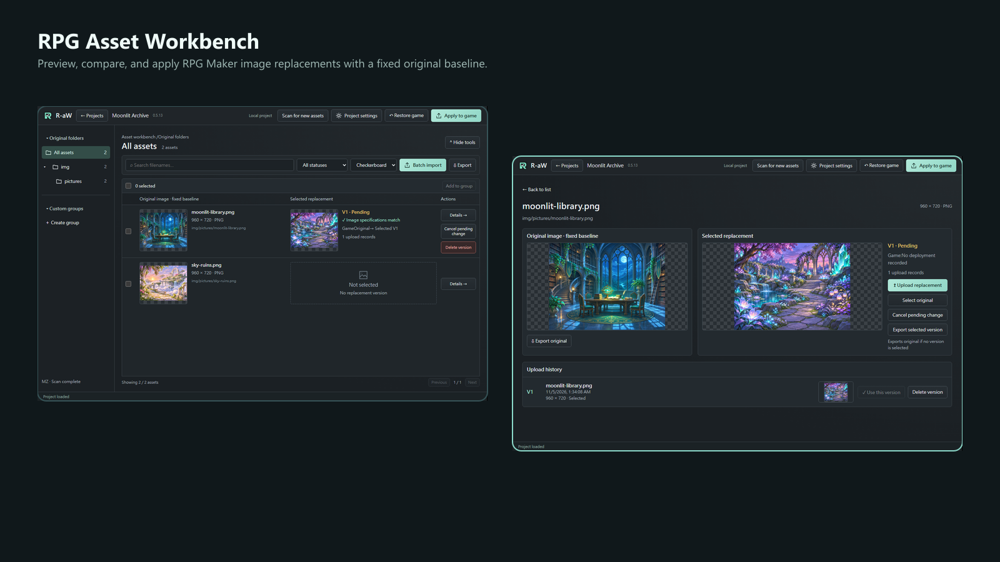
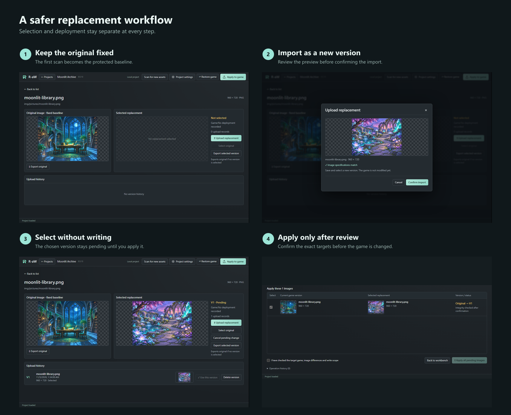

# RPG Asset Workbench（R-aW）

[English](../../README.md) · [繁體中文](README.zh-TW.md) · 简体中文 · [日本語](README.ja.md)

**预览、整理、替换并还原 RPG Maker 图片，同时始终掌握固定原图。**

R-aW 是适用于 Windows 的 RPG Maker MV／MZ 图片素材管理工具。它会保存固定原图基准、分开管理替换版本、支持批量配对，并且只会在明确确认后写入游戏。

## 可以用它做什么

- 浏览原始文件夹、搜索素材并创建自定义群组。
- 比较固定原图、当前选用的替换图与上传历史。
- 导入单张静态 PNG，或批量配对一个文件夹内的替换图。
- 先选用变更而不触碰游戏，检查确切目标后再应用。
- 从保存的固定原图还原指定游戏图片。
- 游戏移动后重新关联位置，同时保留工具管理数据。

## 下载与启动

有可用软件包时，请从本仓库的 **Releases** 页面下载 Windows x64 ZIP。GitHub 的“Source code”ZIP 不是可运行程序；如果页面没有 release asset，表示目前尚无可下载软件包。

将**整个 ZIP** 解压到可写入的文件夹，再打开 `RPG Asset Workbench.exe`。请保留所有随附文件，不要只移动 EXE，也不要直接在 ZIP 内运行。打包版本不需要另行安装 Node.js。

## 更安全的替换流程

1. 先独立备份游戏，并从可信、未修改的游戏副本创建项目。
2. 等待第一次扫描完成。这次扫描会成为固定原图基准；取消会保留进度供之后继续扫描，但扫描未完成时不能应用。
3. 在工作台浏览或搜索素材；点击原图或替换图预览可以放大检查。
4. 将单张静态 PNG 拖到素材上以创建替换版本，或使用批量导入，并在确认前逐一检查配对。
5. 选用版本只会创建待应用变更。打开“应用到游戏”、检查目标并确认后，工具才会写入游戏文件。
6. 选回原图也只会创建待应用变更；应用后即可还原该素材，同时保留替换历史。

### 请记住三条规则

1. **原图基准固定不变。** 后续扫描可以加入经确认的新路径，但不会覆盖已有原图备份。
2. **选用不等于部署。** 导入或选用版本不会修改游戏；应用与还原都有独立确认步骤。
3. **检测到意外的外部变更时停止写入。** 游戏文件与记录状态不符时会阻止应用／还原，没有强制覆盖选项。

首页的语言菜单可以切换英文、繁体中文、简体中文与日文。项目设置提供名称、封面与位置重新关联；自定义群组可以重命名或调整成员，不会删除图片数据。

## 数据、升级与删除

- 工具数据存放在 Windows 用户的应用数据目录，不会全部放在 EXE 旁。移动或删除解压后的程序文件夹，不会同时移动或清除项目管理数据。
- 升级前请关闭 R-aW，并同时备份游戏与完整工具数据目录。将新版本解压到另一个文件夹；如果升级后看不到已有项目，请停止操作并反馈，不要重建或删除项目。
- **永久删除项目会移除工具管理的原图备份、替换版本与还原历史。游戏文件会保持当前状态，删除项目不会自动还原。** 如果你的目的是回到原图，请先还原并确认。
- 移除自定义群组或成员只会移除分类关联。取消待应用与删除版本不同；原图与已部署版本不能单独删除。

## 兼容性与当前限制

- 支持使用未加密或标准加密图片的 RPG Maker MV／MZ；不保证支持自定义加密或修改过的引擎。
- 当前目标为 Windows x64；最低 Windows 版本与 ARM64 尚未验证。
- 仅支持静态 PNG；拒绝 JPEG、APNG 与伪装扩展名。文件上限为 32 MiB。
- 普通图片上限为 16,777,216 像素。替换与批量导入可在确认后处理至 33,554,432 像素；原图扫描与项目封面仍保持普通上限。
- 游戏离线时仍可查看已保存数据，但在位置恢复有效前禁止写入。
- 操作失败后请按恢复提示处理，并保留备份与错误信息。

## 项目状态

当前源码版本为 **0.5.13**，正在准备 1.0 发布，但尚未宣布发布。干净 Windows、最终软件包、升级兼容性与第三方声明仍有待完成项目。

人类主导项目方向、需求、决策与验收；AI 负责软件开发。

## 问题反馈与许可

请使用仓库的 Issues（如果已启用），提供 R-aW、Windows 与 RPG Maker 版本、复现步骤、预期与实际结果，以及相关截图。请遮盖个人路径，不要上传私人游戏、加密密钥或未经授权的素材。

本软件采用 [MIT License with the Commons Clause](../../LICENSE)，Copyright © 2026 Zeke Gan。你可以使用和修改软件，但不得销售本软件，或销售以本软件为主要价值的产品／服务；更名或更换 LOGO 不影响此限制。允许使用 R-aW 制作商业游戏。0.5.11（含）以前版本继续使用纯 MIT；第三方组件与游戏素材各自保留原许可。

[版本更新](../UPDATE_0.5.13.md) · [开发与 AI 文档](../development/INDEX.md)
