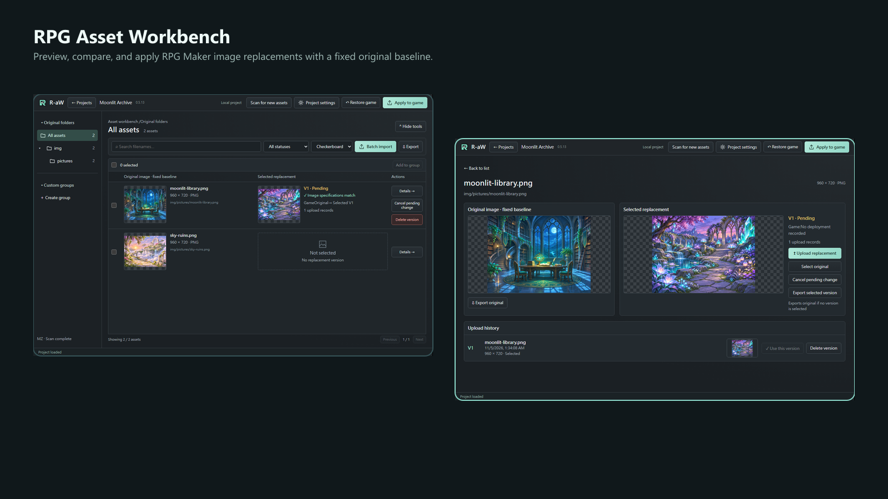
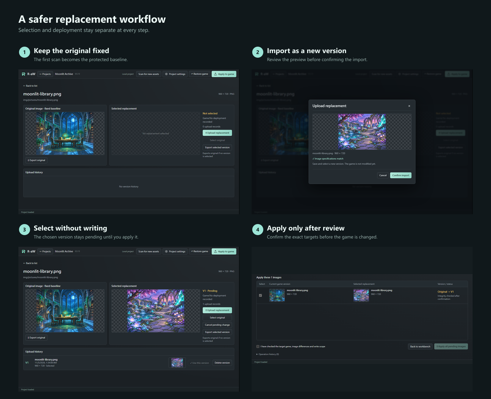

# RPG Asset Workbench（R-aW）

[English](../../README.md) · 繁體中文 · [简体中文](README.zh-CN.md) · [日本語](README.ja.md)

**預覽、整理、替換並還原 RPG Maker 圖片，同時始終掌握固定原圖。**

R-aW 是適用於 Windows 的 RPG Maker MV／MZ 圖片素材管理工具。它會保存固定原圖基準、分開管理替換版本、支援批量配對，並且只會在明確確認後寫入遊戲。

## 可以用它做什麼

- 瀏覽原始資料夾、搜尋素材並建立自訂群組。
- 比較固定原圖、目前選用的替換圖與上傳歷史。
- 匯入單張靜態 PNG，或批量配對一個資料夾內的替換圖。
- 先選用變更而不碰遊戲，檢查確切目標後再套用。
- 從保存的固定原圖還原指定遊戲圖片。
- 遊戲移動後重新連結位置，同時保留工具管理資料。

## 下載與啟動

有可用套件時，請從本儲存庫的 **Releases** 頁面下載 Windows x64 ZIP。GitHub 的「Source code」ZIP 不是可執行程式；若頁面沒有 release asset，表示目前尚無可下載套件。

將**整個 ZIP** 解壓縮至可寫入的資料夾，再開啟 `RPG Asset Workbench.exe`。請保留所有隨附檔案，不要只移動 EXE，也不要直接在 ZIP 內執行。打包版本不需另行安裝 Node.js。

## 較安全的替換流程

1. 先獨立備份遊戲，並從可信任、未修改的遊戲副本建立專案。
2. 等待第一次掃描完成。這次掃描會成為固定原圖基準；取消會保留進度供之後續掃，但掃描未完成時不能套用。
3. 在工作臺瀏覽或搜尋素材；點擊原圖或替換圖預覽可以放大檢查。
4. 將單張靜態 PNG 拖到素材上以建立替換版本，或使用批量匯入，並在確認前逐一檢查配對。
5. 選用版本只會建立待套用變更。開啟「套用到遊戲」、檢查目標並確認後，工具才會寫入遊戲檔案。
6. 選回原圖也只會建立待套用變更；套用後即可還原該素材，同時保留替換歷史。

### 請記住三項規則

1. **原圖基準固定不變。** 後續掃描可以加入經確認的新路徑，但不會覆寫既有原圖備份。
2. **選用不等於部署。** 匯入或選用版本不會修改遊戲；套用與還原都有獨立確認步驟。
3. **偵測到非預期的外部變更時停止寫入。** 遊戲檔案與紀錄狀態不符時會阻擋套用／還原，沒有強制覆寫選項。

首頁的語言選單可切換英文、繁體中文、簡體中文與日文。專案設定提供名稱、封面與位置重新連結；自訂群組可重新命名或調整成員，不會刪除圖片資料。

## 資料、升級與刪除

- 工具資料存放於 Windows 使用者的應用程式資料目錄，不會全部放在 EXE 旁。移動或刪除解壓後的程式資料夾，不會一起移動或清除專案管理資料。
- 升級前請關閉 R-aW，並同時備份遊戲與完整工具資料目錄。將新版本解壓到另一個資料夾；若升級後看不到既有專案，請停止操作並回報，不要重建或刪除專案。
- **永久刪除專案會移除工具管理的原圖備份、替換版本與還原歷史。遊戲檔案會維持當下狀態，刪除專案不會自動還原。** 若你的目的是回到原圖，請先還原並確認。
- 移除自訂群組或成員只會移除分類關聯。取消待套用與刪除版本不同；原圖與已部署版本不能單獨刪除。

## 相容性與目前限制

- 支援未加密或標準加密圖片的 RPG Maker MV／MZ；不保證支援自訂加密或修改過的引擎。
- 目前目標為 Windows x64；最低 Windows 版本與 ARM64 尚未驗收。
- 僅支援靜態 PNG；拒絕 JPEG、APNG 與偽裝副檔名。檔案上限為 32 MiB。
- 一般圖片上限為 16,777,216 像素。替換與批量匯入可在確認後處理至 33,554,432 像素；原圖掃描與專案封面仍維持一般上限。
- 遊戲離線時仍可查看已保存資料，但在位置恢復有效前禁止寫入。
- 操作失敗後請依恢復提示處理，並保留備份與錯誤資訊。

## 專案狀態

目前原始碼版本為 **0.5.13**，正準備 1.0 發行，但尚未宣布發布。乾淨 Windows、最終套件、升級相容性與第三方聲明仍有待完成項目。

人類主導專案方向、需求、決策與驗收；AI 負責軟體開發。

## 問題回報與授權

請使用儲存庫的 Issues（若已啟用），提供 R-aW、Windows 與 RPG Maker 版本、重現步驟、預期與實際結果，以及相關截圖。請遮蔽個人路徑，不要上傳私人遊戲、加密金鑰或未獲授權素材。

本軟體採用 [MIT License with the Commons Clause](../../LICENSE)，Copyright © 2026 Zeke Gan。你可以使用及修改軟體，但不得販售本軟體，或販售以本軟體為主要價值的產品／服務；更名或更換 LOGO 不影響此限制。允許使用 R-aW 製作商業遊戲。0.5.11（含）以前版本維持純 MIT；第三方元件與遊戲素材各自保留原授權。

[版本更新](../UPDATE_0.5.13.md) · [開發與 AI 文件](../development/INDEX.md)
